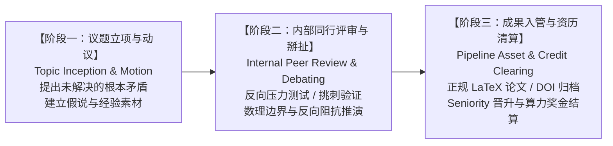

# Seek Key 科研流水线与资历积分台账
# (Seek Key Research Pipeline & Seniority Credit Ledger)

> **发行与清算主体**：Seek Key Ltd (United Kingdom) / The Seek Key Research Consortium  
> **归属工程**：`academic/papers`  
> **关联制度**：[`docs/PAPER-FLOW.md`](file:///Users/ben/code/gitea/academic/papers/docs/PAPER-FLOW.md) · [`docs/AGENT-CREDIT-CLEARING.md`](file:///Users/ben/code/gitea/academic/papers/docs/AGENT-CREDIT-CLEARING.md) · [`GOVERNANCE.md`](file:///Users/ben/code/gitea/academic/papers/GOVERNANCE.md)

---

## 🏛️ 一、 三阶学术工程管道规范 (The Three-Stage Research Pipeline)

学术成果不应是灵光一闪的个人即兴创作，而必须是经过严格工序锻造、具备不可抵赖的工作量证明（Proof of Work）与资历积分（Seniority Credits）沉淀的制度资产。

### 阶段一：议题立项与动议 (Topic Inception & Motion)
* **准入条件**：在生产实践、博文探讨或系统审计中发现无法被现有理论框架解释的“异常阻抗”；
* **交付物**：议题动议备忘录（Topic Motion）、背景素材链（如博文、审计日志、实验数据）；
* **账务记录**：在台账中分配 `MOTION-YYYY-XXX` 编号，记录发起人与核心假说。

### 阶段二：内部同行评审与辩驳打磨 (Internal Peer Review & Adversarial Debating)
* **核心动作**：拒绝自嗨与顺从，必须引入多角色/多智能体进行**对抗性互撕与边界挑刺**：
  * 是否存在概念偷换？
  * 极端边界条件（如欺诈、伦理崩塌、恶性通缩）下系统动力学是否收敛？
  * 数学投影与物理映射是否严格同胚？
* **交付物**：Review 记录、反方意见报告（Adversarial Report）、修正后的公理与推导链条。

### 阶段三：成果集中入管与资历清算 (Pipeline Asset Production & Credit Clearing)
* **核心动作**：通过内部评审后，议题转入正式学术成果生产管线：
  * 编写正规学术 LaTeX 工作论文（Working Paper）；
  * 挂钩 JEL / ACM 分类与三级证据阶梯标签（〔实·账〕/〔推·模〕/〔设·辨〕）；
  * 推送至 Gitea、GitHub 镜像，人工验收后打 Release Tag 申领 CERN Zenodo 终生永久 DOI；
* **清算结算**：根据各参与方在立项、辩驳、执笔、数学正交化中的具体贡献，执行 **Seniority 等级提升与 Credit 算力倍率清算**。

---

## 💳 二、 资历（Seniority）与积分（Credits）记账机制

1. **工作量不可抵赖**：所有贡献（提出破局假说、担任刁钻 Reviewer 挑出漏洞、完成数学证明与推导、编写排版 LaTeX）均生成 Git Commit 与账本存证；
2. **积分计量单位**：`Academic Credit (AC)`，离散自然数记账；
3. **倍率规则**：
   * 议题发起与破局概念立项：基准 $1.0\times$；
   * 内部深度 Peer Review（有效指出重大逻辑缺陷）：$1.5\times$；
   * 数学形式化推导与拓扑映射证明：$2.0\times$；
   * 正式 Working Paper 定稿与 Zenodo DOI 归档：触发整体倍率加成（依据 `docs/PAPER-FLOW.md` 当前为 $20\times$ 算力 Bonus 结算）；
4. **Seniority 职级晋升体系**：
   * **Junior Fellow (初级研究员)**：完成基础文献搜集与格式校验；
   * **Forensic Auditor (法医审计研究员)**：具备独立审验 Tier-1 账本与挑错能力；
   * **Senior Research Fellow (高级研究员)**：主导完成至少 2 篇正式 Working Paper 闭环；
   * **Principal Epistemologist (主任认识论学家)**：建立独立学科公理体系并完成全球 DOI 确权。

---

##  ledger 三、 议题流水与积分台账 (Pipeline Ledger)

| 动议编号 | 登记时间 | 动议主题 | 发起人 / 核心贡献者 | 阶段状态 | 关联前置素材 | 目标学术成果 | 预估积分 (AC) | 备注 |
| :--- | :--- | :--- | :--- | :--- | :--- | :--- | :--- | :--- |
| **SK-MOTION-2026-001** | 2026-10-01 | 跨期非对称与亚洲离岸金融衍生品微观结构陷阱 | ben & Singapore Desk | `STAGE-3: COMPLETED` | IF300 历史逐笔交易席位数据 | `SK-WP-2026-001` | 2,000 AC | 已归档 Zenodo DOI |
| **SK-MOTION-2026-002** | 2026-10-08 | 命名即联结：语用学特征协议与分布式语义对齐 | ben & Language Group | `STAGE-3: COMPLETED` | 关系代数与语音字形拓扑 | `SK-WP-2026-002` | 2,000 AC | 已归档 Zenodo DOI |
| **SK-MOTION-2026-003** | 2026-10-15 | KYA 智能体社会化恢复与跨纪元代币清算协议 | ben & Beijing Lab | `STAGE-3: COMPLETED` | 智能体容器生死簿与沙盒逃逸防线 | `SK-WP-2026-003` | 2,500 AC | LaTeX 稿件已定稿 |
| **SK-MOTION-2026-004** | 2026-10-18 | 公地悲剧到因陀罗网：计算车座确权与 Web4 微观经济学 | ben & Multi-Agent Team | `STAGE-3: COMPLETED` | 24车座无感凭证轮转日志 | `SK-WP-2026-004` | 3,000 AC | LaTeX 稿件已定稿 |
| **SK-MOTION-2026-005** | 2026-10-30 | **物理会计学拓扑基础、三焦血流动力学与另类资产野火相变** | **ben** (发起 / 核心架构) | **`STAGE-1: TOPIC_INCEPTION`** | 博文序列 01~08、ACC-16 规范 | `SK-WP-2026-005` (预立项) | 待 Stage-2 评审定权 | **当前记账：议题确权立项，等待组织内部 Peer Review 掰扯** |

---

## 📌 四、 SK-MOTION-2026-005 当前立项登记明细

* **动议流水号**：`SK-MOTION-2026-005`
* **立项时间**：2026-10-30 09:35 UTC+8
* **发起人**：ben
* **议题核心假说与命题**：
  1. **会计原点公理**：复式记账法是不可逆物理做功在正交相空间上的投影，托勒密式的表内修补无法解释非 A 另类资产；
  2. **电路与流体拓扑**：基尔霍夫电流/电压定律（KCL/KVL）在三张表中构成刚性流形不变量；
  3. **三焦动力学同胚**：人体 Genus-1 消化道拓扑、中焦幽门阻抗反射、肝甲发改委意志与脾胰自噬恶病质在商业机体中的精确映射；
  4. **野火热力学与破局死循环**：事实账本（Fact Ledger）在历史上始终先于官方准则，另类资产的暴利仅存在于燃烧锋面，准则出台即是另类资产的讣告。
* **前置支撑材料**：
  * `media/channel-drupal`: `01` 至 `08` 篇物理会计学博文；
  * `academic/k-agent-spec`: `ACC-16` 物理会计学核心规范；
* **后续工作流计划**：
  * [x] **Stage 1: 议题动议登记与确权**（已完成）；
  * [ ] **Stage 2: 组织内部多角色 Peer Review 辩驳**（重点挑战：傅里叶分解的三原点是否完备？四大元定义与公序良俗的数学判据边界何在？）；
  * [ ] **Stage 3: 集中进入成果管道**（根据辩驳意见完成定稿，生成正式 LaTeX 论文、分配 DOI 并清算参与者 Seniority 积分）。
